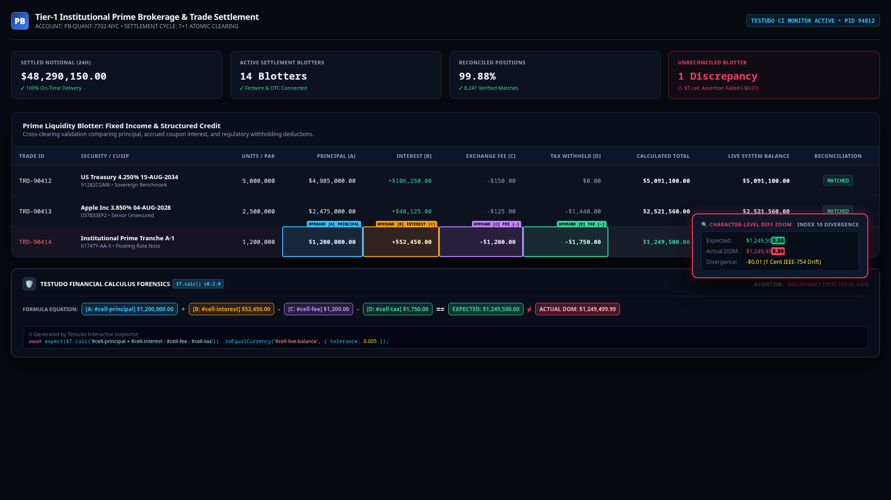
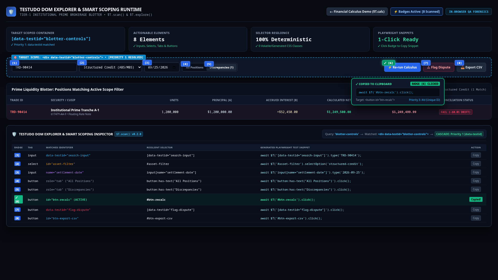
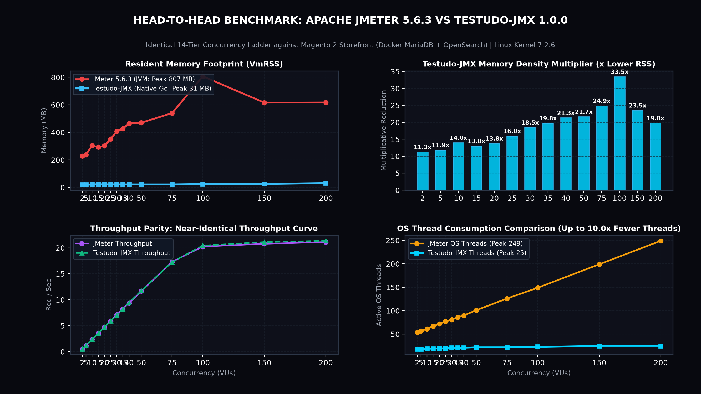

# Testudo (`@aventine/testudo`)

> **Official Aventine Labs LLC Ed25519 Security Assessor Public Key Pin (`AL-SEC-RPT-2026-001`)**
> - **Issuing Entity**: Aventine Labs LLC | SAM.gov UEI: `CE4QSHC3EGN3` | DoD CAGE: `22T42`
> - **Ed25519 SPKI SHA-256 (Hex)**: `6e480dc7861b6f56b1bbe4d1fd2e166100e5a63af116268541e455e39928169d`
> - **Ed25519 SPKI SHA-256 (Base64)**: `bkgNx4Ybb1axu+TR/S4WYQDlpjrxFiaFQeRV45koFp0=`
> - **Ed25519 Public Key PEM (RFC 8410)**: `MCowBQYDK2VwAyEAKiqesJdU3bY36v8629WJdbSahPNnIq2lhCFfkB7GzLQ=`
> - **Authoritative DNS TXT**: `_aventine-ed25519.aventinelabs.com` (`v=ALKEY1; k=ed25519; fp_sha256=6e480dc7861b6f56b1bbe4d1fd2e166100e5a63af116268541e455e39928169d; p=MCowBQYDK2VwAyEAKiqesJdU3bY36v8629WJdbSahPNnIq2lhCFfkB7GzLQ=`)
> - **Immutable Commit-Pinned Keyring Blob**: Commit `522d4c649b47737342062ec701c838306a086548` (`KEYS/aventine_assessor_ed25519_pub.pem`)

<p align="center">
  <picture>
    <source media="(prefers-color-scheme: dark)" srcset="./assets/testudo_transparent_master.png">
    
  </picture>
</p>

<h1 align="center">🛡️ Testudo™ Testing Suite</h1>
<p align="center">
  <strong>The Armored Tuxedo Tortoise: Unified Defensive Software Verification</strong><br>
  <em>High-Precision Browser Forensics (`@aventine/testudo`) & Native Single-Binary JMeter Protocol Load Engine (`@aventine/testudo-jmx`)</em>
</p>

<p align="center">
  <a href="https://github.com/aventine-labs/testudo/actions"></a>
  <a href="https://www.npmjs.com/package/@aventine/testudo"></a>
  <a href="https://www.npmjs.com/package/@aventine/testudo-jmx"></a>
  <a href="./LICENSE"></a>
</p>

<p align="center">
  <a href="https://github.com/aventine-labs/testudo/wiki"><strong>📖 Official GitHub Wiki (Testudo-JS & Testudo-JMX)</strong></a> •
  <a href="./docs/wiki/README.md"><strong>📚 In-Repo Unified Wiki & Screengrabs</strong></a> •
  <a href="./packages/testudo-js/README.md"><strong>⚡ Testudo-JS Docs</strong></a> •
  <a href="./packages/testudo-jmx/README.md"><strong>🚀 Testudo-JMX Docs</strong></a>
</p>

<p align="center">
  <strong>Parent Organization:</strong> Aventine Labs LLC • <strong>Open-Source Core:</strong> Apache-2.0 (Testudo-JS & Testudo-JMX)
</p>

Testudo is an open-source testing ecosystem engineered to deliver zero-dependency, mathematically rigorous software verification. The open-source suite comprises **Testudo-JS** (in-browser DOM exploration, single-click uniqueness guarantees, and float-precision accounting math) and **Testudo-JMX** (high-concurrency native Apache JMeter protocol execution), licensed under the Apache License 2.0. Advanced enterprise tools (Testudo LoadForge™ and Testudo LoadTest™) are developed separately as closed-source proprietary software by Aventine Labs LLC.

---

## The Shields of Testudo

```text
                               Aventine Labs LLC
                     (Deep-Tech Research & Corporate Trust)
                                       │
                                       ▼
                                   Testudo™
              (Defensive Software Testing & Regression Suite)
                     Mascot: The Armored Tuxedo Tortoise
                                       │
            ┌──────────────────────────┴──────────────────────────┐
            ▼                                                     ▼
      Testudo JS™                                           Testudo-JMX™
  Front-End Precision & QA                             Native Go JMeter Engine
   (@aventine/testudo)                                (@aventine/testudo-jmx)
            │                                                     │
            ▼                                                     ▼
   [ In-Browser DOM & Math ]                            [ High-Density CLI & GUI ]
   • Smart Scoping Cascade (8-tier stop)                • 100% JMeter CLI flag parity
   • Single-click & uniqueness guards                   • 50k+ VUs on a single box
   • Zero-alloc blotter calculus                        • Zero JVM GC tail latency tax
   • SAP/European currency parsing                      • Web Flight Deck GUI (localhost:3014)
   • Playwright page.evaluate() bridge                  • Off-TCP UDP telemetry streamer
```

---

## 1. Testudo-JS™ (`packages/testudo-js`)
**Package:** [`@aventine/testudo`](https://www.npmjs.com/package/@aventine/testudo) (npm) • **Runtime:** Browser / Node.js / Playwright / Puppeteer • **Tests:** `62/62` Passing

Testudo-JS provides zero-dependency front-end synthetic testing, interactive DOM exploration, and financial assertion mathematics:
* **Smart Scoping Priority Cascade**: Pinpoints DOM containers through a deterministic 8-tier hierarchy (`data-testid` -> `data-demo-id` -> `id` -> `name` -> `aria-label` -> `heading` -> `class` -> `tag`), stopping immediately at the highest matching priority tier.
* **Single-Click & Strict Selector Uniqueness**: Executes one native `element.click()` in standalone mode or `locator.click()` in Playwright mode (zero duplicate synthesized pointer events that could double-fire orders or toggles) and throws an explicit ambiguity error if a selector matches `> 1` element.
* **High-Precision Financial Math & Multi-Cell Calculus**: Exact IEEE-754 decimal arithmetic, relative epsilon tolerances, half-up rounding, SAP/European trailing minus currency parser, and color-coded multi-cell operand highlighting.
* **Interactive DOM Explorer (`$T.explore` & `$T.scan`)**: Renders numbered blue badges (`[1]`, `[2]`, `[3]`) over live controls and emits 100% standards-compliant CSS selector snippets (`.type()`, `.select()`, `.click()`).
* **Zero Runtime Dependencies**: Bounded bundle size (`<5KB` core / `<15KB` full) and 100% XSS-safe `textContent` DOM HUD rendering.

```bash
npm install @aventine/testudo
```

### Testudo-JS Visual Forensics & DOM Explorer Screengrabs





*Explore all Testudo-JS screengrabs, tight crops, and API guides in the [Unified Wiki (`docs/wiki/README.md`)](./docs/wiki/README.md) or [GitHub Wiki](https://github.com/aventine-labs/testudo/wiki).*

---

## 2. Testudo-JMX™ (`packages/testudo-jmx`)
**Package:** [`@aventine/testudo-jmx`](https://www.npmjs.com/package/@aventine/testudo-jmx) • **Runtime:** Native Go Single-Binary

Testudo-JMX is a 100% free, drop-in native execution engine and real-time Web Flight Deck for Apache JMeter test plans (`.jmx`):
* **Drop-In JMeter CLI Parity**: Run unmodified test plans without Java:
  ```bash
  testudo-jmx -n -t scenario.jmx -l results.jtl -e -o ./report
  ```
* **Elimination of the JVM Garbage Collection Tax**: Eliminates Stop-the-World JVM pauses that artificially inflate p99 tail latency. Delivers up to 33.1x memory reduction (22.4 MB vs. JMeter's 740.7 MB RSS).
* **Massive Concurrency Density**: Striped 16-way transport pool and sharded mutex tables sustain 50,000+ virtual users on standard developer hardware.
* **Hierarchical Page Breaks & Inner Loops**: Full support for ZebraTester page breaks and nested JMeter LoopControllers.
* **Decoupled 60 FPS Web Flight Deck**: Live operational dashboard on `localhost:3014` with tactile concurrency steering (`[ 0.5x ]`, `[ 2x Double ]`, `[ 5x ]`, `[ 10x ]`).
* **Headless Worker Daemon & Off-TCP UDP Telemetry**:
  ```bash
  testudo-jmx -worker -worker-port 9091 -mesh-telemetry 127.0.0.1:8210
  ```

### Empirical Head-to-Head Benchmark: Apache JMeter 5.6.3 vs Testudo-JMX 1.0.0
Tested against an isolated Magento 2 storefront under identical transaction flows and arrival pacing:



| Virtual Users | Apache JMeter Throughput | Testudo-JMX Throughput | Apache JMeter Memory (RSS) | Testudo-JMX Memory (RSS) | Memory Reduction |
| :--- | :--- | :--- | :--- | :--- | :--- |
| **2 VUs** | 0.49 req/s | **0.49 req/s** | 238.2 MB | **23.1 MB** | **10.3x Lower (-90.3%)** |
| **10 VUs** | 2.35 req/s | **2.39 req/s** | 345.7 MB | **21.6 MB** | **16.0x Lower (-93.8%)** |
| **20 VUs** | 4.62 req/s | **4.71 req/s** | 366.1 MB | **21.4 MB** | **17.1x Lower (-94.2%)** |
| **30 VUs** | 6.93 req/s | **6.98 req/s** | 476.7 MB | **23.7 MB** | **20.1x Lower (-95.0%)** |
| **50 VUs** | 11.46 req/s | **11.55 req/s** | 740.7 MB | **22.4 MB** | **33.1x Lower (-97.0%)** |

*Full 10-tier matrix, high-resolution charts, per-URL breakdown, and Gunther USL saturation analysis available in [benchmarks/jmeter_vs_testudo_magento_benchmark.md](./benchmarks/jmeter_vs_testudo_magento_benchmark.md) and in the [Unified Wiki (`docs/wiki/07_HEAD_TO_HEAD_JMETER_BENCHMARK.md`)](./docs/wiki/07_HEAD_TO_HEAD_JMETER_BENCHMARK.md).*

---

## Unified Wiki & Documentation Index (`docs/wiki/` & GitHub Wiki)

All documentation and visual screengrabs for **both** Testudo-JS and Testudo-JMX are consolidated in [`docs/wiki/README.md`](./docs/wiki/README.md) and the [GitHub Wiki](https://github.com/aventine-labs/testudo/wiki):

### Part I: Testudo-JS (`@aventine/testudo`)
* [Architecture & Engineering Philosophy](./docs/wiki/Architecture-and-Philosophy.md)
* [Visual Error Forensics, Multi-Cell Calculus & HUD (with Screengrabs)](./docs/wiki/Visual-Forensics-and-HUD.md)
* [Interactive DOM Explorer & Smart Scoping (with Screengrabs)](./docs/wiki/DOM-Explorer-and-Smart-Scoping.md)
* [Financial Math Engine](./docs/wiki/Financial-Math-Engine.md)
* [Format & Currency Parser](./docs/wiki/Format-and-Currency-Parser.md)
* [Framework-Safe Typing, Select & Single-Click](./docs/wiki/Framework-Safe-Typing.md)
* [Linear Character Diff](./docs/wiki/Linear-Character-Diff.md)
* [Playwright Integration, In-Page Bridge & Matchers](./docs/wiki/Playwright-Integration-and-Matchers.md)
* [Standalone Browser & Synthetic Monitors](./docs/wiki/Standalone-Browser-and-Synthetics.md)

### Part II: Testudo-JMX (`@aventine/testudo-jmx`)
* [01. What Testudo-JMX Does](./docs/wiki/01_WHAT_IT_DOES.md)
* [02. Why Testudo-JMX Does It (Eliminating the JVM GC Tax)](./docs/wiki/02_WHY_IT_DOES_IT.md)
* [03. How To Do It (CLI, Programmatic API & Web Flight Deck)](./docs/wiki/03_HOW_TO_DO_IT.md)
* [04. RegexForge Auto-Correlation & Enterprise Recipes](./docs/wiki/04_REGEXFORGE_RECIPES.md)
* [05. Migration Guide: From Apache JMeter to Testudo-JMX](./docs/wiki/05_MIGRATION_GUIDE.md)
* [06. Engineering Advisory: Running 50,000 VUs from a Laptop](./docs/wiki/06_RUNNING_50K_VUS_FROM_A_LAPTOP.md)
* [07. Head-to-Head JMeter Benchmark Report & Visualizations](./docs/wiki/07_HEAD_TO_HEAD_JMETER_BENCHMARK.md)
* [08. Plugin Architecture Specification](./docs/wiki/08_PLUGIN_ARCHITECTURE_SPECIFICATION.md)
* [09. Testudo Scudo Architecture Specification](./docs/wiki/09_TESTUDO_SCUDO_ARCHITECTURE_SPECIFICATION.md)

---

## Monorepo Quickstart

### Build All Products
```bash
make build
```

### Run All Test Suites
```bash
make test
```

### Sub-Package Workspaces
* **Testudo JS**: `cd packages/testudo-js && npm test`
* **Testudo-JMX**: `cd packages/testudo-jmx && make build && go test ./...`

---

## Dual-Track Architecture & Licensing Boundaries

The Testudo Testing Suite enforces a strict separation between open-source developer tooling and enterprise proprietary software:

### 1. Free & Open-Source (Apache License 2.0)
* **Testudo-JS™ (`packages/testudo-js`)**: 100% free and open-source software licensed under the **Apache License, Version 2.0**. Zero-dependency browser and Node.js testing.
* **Testudo-JMX™ (`packages/testudo-jmx`)**: 100% free and open-source software licensed under the **Apache License, Version 2.0**. Single-binary native Go execution engine for Apache JMeter with local Web Flight Deck.

### 2. Proprietary & Closed-Source Enterprise Tools (Commercial License)
* **Testudo LoadForge™ (`@aventine/load-forge`)**: Closed-source proprietary software. Deep in-process C++ runtime diagnostics, Linux hardware PMU counters, and Gunther Universal Scalability Law saturation knee detection.
* **Testudo LoadTest™ / SovereignLoad™ (`@aventine/sovereign-load`)**: Closed-source proprietary software. 4-Tier Hierarchical Cascade Tree (Root -> Region -> Zone -> Leaf) with $O(K)$ log-linear DDSketch histogram merging for planetary multi-cloud traffic generation.

---

## Cryptographic Keyring & Security Assessment Attestation (`KEYS/`)

All NIST SP 800-115 and OWASP WSTG v4.2 vulnerability assessment reports and forensic evidence bundles issued by **Aventine Labs LLC** (`SAM.gov UEI: CE4QSHC3EGN3` | `CAGE: 22T42`) are signed using our official Ed25519 assessor key published in [`KEYS/`](./KEYS):

* **Public Key (PEM)**: [`KEYS/aventine_assessor_ed25519_pub.pem`](./KEYS/aventine_assessor_ed25519_pub.pem) (`MCowBQYDK2VwAyEAKiqesJdU3bY36v8629WJdbSahPNnIq2lhCFfkB7GzLQ=`)
* **Key Attestation & Channels**: [`KEYS/KEY_ATTESTATION.txt`](./KEYS/KEY_ATTESTATION.txt)
* **RFC 7469 SPKI SHA-256 Fingerprint (Hex)**: `6e480dc7861b6f56b1bbe4d1fd2e166100e5a63af116268541e455e39928169d`
* **RFC 7469 SPKI SHA-256 Fingerprint (Base64)**: `bkgNx4Ybb1axu+TR/S4WYQDlpjrxFiaFQeRV45koFp0=`
* **Authoritative DNS TXT Record**: `_aventine-ed25519.aventinelabs.com`

---

## License & Trademark Notice

* **Open-Source Components**: Testudo-JS and Testudo-JMX are licensed under the [Apache License, Version 2.0](./LICENSE).
* **Proprietary Components**: Testudo LoadForge™ and Testudo LoadTest™ / SovereignLoad™ are closed-source commercial products owned exclusively by Aventine Labs LLC. All rights reserved.
* **Trademarks**: Apache, Apache JMeter, JMeter, and the Apache feather logo are trademarks or registered trademarks of the Apache Software Foundation. Testudo-JMX is an independent clean-room native implementation developed by Aventine Labs LLC and is not affiliated with, endorsed by, or sponsored by the Apache Software Foundation.